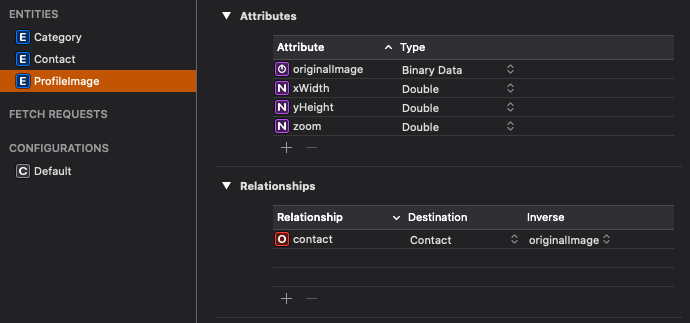

Photo Select and Crop
=====================

This Swift Package integrates the SwiftUI `PhotosPicker` (PhotosUI) into a SwiftUI app and allows a user to select, scale and position an image to be cropped and saved as a contact's photo, similar to the stock iOS Contacts app. To accomplish this, the project uses a `composeImageAttributes()` function to send four variables to the parent view:

1) a copy of the original `UIImage`,
2) a scaled and / or cropped `UIImage` version of it,
3) a `CGFloat`, and 
4) a `CGPoint`. 

The `CGFloat` and `CGPoint` represent the scale and position of the original image used to make the processed version. 

> :point_up: By saving the original image and scale and position markers and passing them to the `ImageMoveAndScaleSheet` view, if the user taps the "Change photo" button, the original photo is scaled and positioned to allow subsequent adjustments.
> 

## Requirements

- iOS 17.0+
- Swift 5.9+ / Xcode 15+ (Xcode 16 recommended)

## Implementation

Add an ImagePane view to your parent view like this:

`ImagePane(image: image, isEditMode: $isEditMode, renderingMode: renderingMode, colors: colors)`

Using CoreData, one might do the following. Define two entities: `Contact` and `ProfileImage`, where `Contact` has a `To One` relationship to `ProfileImage`. The `ProfileImage` entity should have properties that can be mapped to the variables provided to the `ImageDisplay` struct after the user has selected an image from their library.

Then, an `ImageAttributes` class should be initialized with the properties from the Core Data entity. This `ImageAttributes` class is then passed to the `ImagePane` as in the above code. For the nil case, a second `ImageAttributes` struct is initialized, this time with a default image named `avatar` which was saved to the project's Image Assets folder. 

An `ImageAttributes` object can easily be defined as a placeholder.  

With an SF Symbol: `let placeholderAperture = ImageAttributes(withSFSymbol: "camera.aperture")`

With an image from the Assets folder: `let placeholderAvatar = ImageAttributes(withImage: "avatar")`

Examples of working apps using this Package can be found at: https://github.com/Rillieux/Contacts (using CoreData), and https://github.com/Rillieux/PhotoSelectAndCropDemo (a basic working implementation which does not cover persistence).

## Migrating from 2.x to 3.0

Version 3.0 raises the minimum platform to iOS 17, replaces the UIKit pickers with the system SwiftUI `PhotosPicker`, and adopts the Observation framework. (The 1.x and 2.x APIs are the same in the areas affected, so these notes apply equally when coming from 1.x.) The following changes may affect your code:

1. **`SystemUIImagePicker` and `SystemPHPicker` are removed.** The package now presents the system `PhotosPicker` internally; there is nothing to configure. If your app imported these wrapper types directly, adopt `PhotosPicker` from PhotosUI yourself.

2. **`ImageAttributes` is now `@Observable` (and `@MainActor`) instead of `ObservableObject`.**
   - Replace `@StateObject var attributes = ImageAttributes(...)` with `@State private var attributes = ImageAttributes(...)`.
   - Replace `@ObservedObject var attributes: ImageAttributes` with a plain `var attributes: ImageAttributes`.
   - `objectWillChange` and `$attributes` projected values no longer exist.
   - Construct `ImageAttributes` in a main-actor context (any SwiftUI `View` or `App` qualifies). If you build it inside a nonisolated model or CoreData mapping layer, hop to the main actor first.

3. **`ImagePane` now has a single initializer** with defaulted `renderingMode`, `colors`, and `linearGradient` parameters. All of the 1.x call shapes still compile unchanged.

4. **The `Color` shims (`Color.systemRed`, `Color.label`, etc.) are deprecated.** Use `Color(uiColor: .systemRed)` and friends instead; the shims will be removed in a future release.

5. **Localization now actually works.** The package's bundled translations (English and French) are resolved from the package's own resource bundle (`Bundle.module`). If your app previously worked around this by adding the package's string keys (such as "Use photo" or "Move and Scale") to its own `Localizable.strings`, those app-level entries are no longer consulted — the package's bundled translations are used instead. Note that iOS only displays languages the *host app* declares: for the package's French strings to appear, your app must either include French in its own localizations (project ▸ Info ▸ Localizations) or set `CFBundleAllowMixedLocalizations` to `YES` in its Info.plist.
